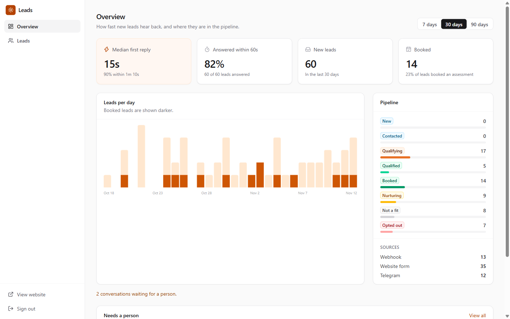
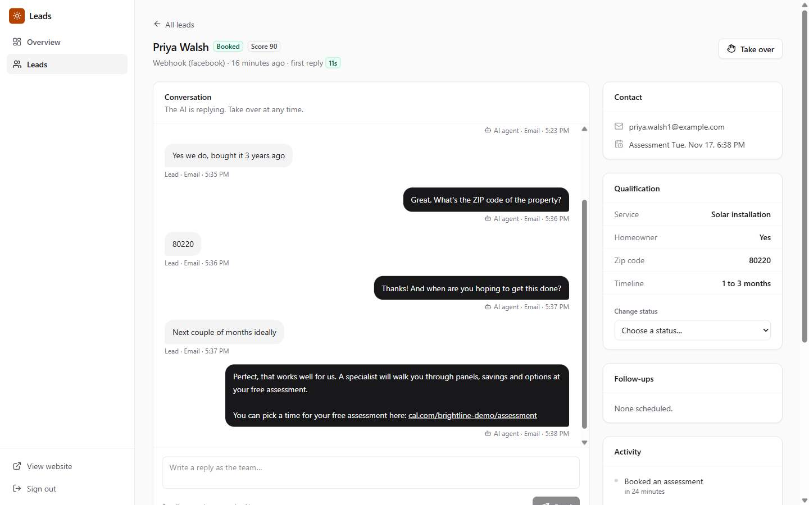
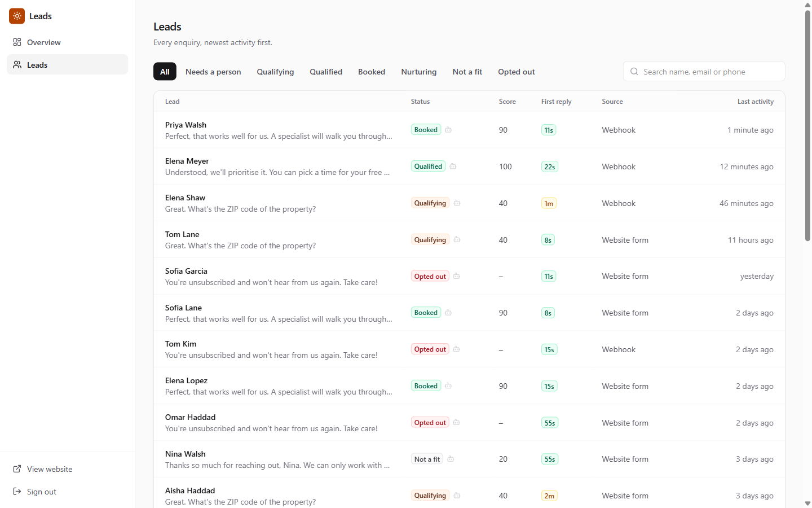
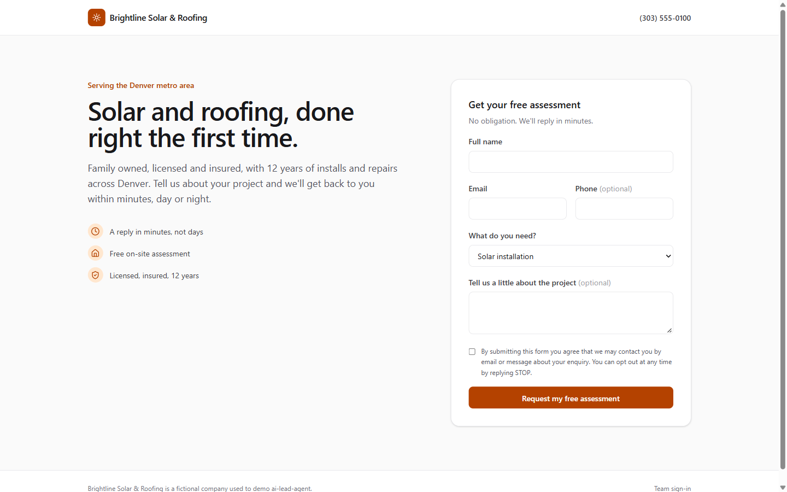

# ai-lead-agent

[](https://github.com/Sanoy24/ai-lead-agent/actions/workflows/ci.yml)
[](LICENSE)

**An AI speed-to-lead agent for service businesses.** Every new lead gets a personal reply within a minute, day or night. The agent asks your qualifying questions, sends qualified leads your booking link, follows up when they go quiet, and logs everything in your CRM, while your team watches every conversation and can take over at any time.

Most leads go to whichever business answers first. A form filled in at 9 pm usually waits until the next morning, and by then the lead has called a competitor. This agent replies in seconds and keeps the conversation going until the lead is booked or politely closed.

**[▶ Watch the 2-minute demo on YouTube](https://youtu.be/X6X4b2D8GlA)**: a lead messages on Telegram, gets qualified and receives the booking link, then the team takes over and a campaign brings old leads back.



## What it does

**For your leads**

- **A reply in under a minute**, by text message, email or Telegram, in your business's voice. Leads come from your website form, any webhook (Facebook Lead Ads, Typeform, Zapier and similar), a text to your business number, or your Telegram bot. Replies go back on the channel the lead last used.
- **A real conversation, not a form.** The agent answers questions about your business, asks one qualifying question at a time, and never asks for something the lead already told it.
- **Booking when they're ready.** Qualified leads get your booking link, prefilled with their name and email. Leads who aren't ready get it as a no-pressure option, and poor fits get a polite close.
- **Follow-ups that stop at the right time.** If a lead goes quiet, a short nudge goes out after 1, 3 and 7 days, never during quiet hours in their time zone. A reply, a booking or "STOP" ends them.

**For your team**

- **Speed-to-lead at a glance.** Median and 90th-percentile time to first reply, the share of leads answered within a minute, bookings and the full pipeline.
- **Every conversation in one place**, across email and Telegram, with the recorded answers, score, appointment, follow-up schedule and an activity log.
- **Take over at any time.** One click pauses the AI so a person can reply from the dashboard; hand it back when you're done. The agent also hands over by itself when someone is upset, reports an emergency or asks for a person.
- **Bring old leads back.** Upload a CSV of past leads or customers and the agent sends each a short, personal opener (outside quiet hours). Replies continue as normal conversations, and the Campaigns page shows who replied and booked. Anyone who ever opted out is skipped automatically.
- **Your CRM stays current.** Leads become HubSpot or GoHighLevel contacts with their stage kept in step, and key moments are added as notes.

<table>
  <tr>
    <td></td>
    <td></td>
  </tr>
  <tr>
    <td align="center"><sub>A lead qualified and booked in five messages</sub></td>
    <td align="center"><sub>Every lead, with its first-reply time against the one-minute target</sub></td>
  </tr>
</table>

<details>
<summary>The demo website with the lead form</summary>



</details>

## How qualification works

The language model and plain code each do what they're good at:

- **The model talks.** It writes warm, short replies, answers questions about the business, and records the lead's answers through a tool generated from your business profile.
- **Code decides.** A scoring module turns the recorded answers into a score and an outcome using your rules: keep qualifying, **qualified** (booking link added), **nurture** (all answers in but not ready), or **not a fit** (polite close). The outcome never depends on the model's judgement, so it's predictable and testable.
- **Everything business-specific lives in one file.** The description, rules the agent must follow (such as "never quote prices"), the questions, scoring and follow-up schedule are in a TOML profile. See [the demo profile](src/lead_agent/demo/business.toml).

## Built to be safe with real leads

| Risk | How it's handled |
|---|---|
| Messaging people who didn't ask | Form and webhook leads must give consent, and the exact consent wording is stored with each lead. A hidden spam-trap field drops bots, and the form is rate limited. |
| Ignoring "STOP" | Opt-out words are caught **before** the model sees the message, confirmed once, and permanent. Every email also has a one-click unsubscribe header. |
| Messages at 3 am | Follow-ups wait for the end of quiet hours in the lead's time zone, even after the server was down. |
| The agent promises prices or dates | Your rules are part of every prompt, and the booking link is added by code, not by the model. |
| Prompt injection ("ignore your instructions...") | Lead messages are treated as data. The agent's only tools are recording answers (which code then scores) and asking for a person, so it can't book, cancel or quote anything. |
| The model is down | A new lead still gets a holding reply within seconds, and the AI pauses so a person can pick the conversation up. |
| Forged webhooks | Lead and Cal.com webhooks must be signed with HMAC-SHA256, and SMS webhooks must carry Twilio's signature. Without a secret, each endpoint is off. |
| The dashboard is attacked | Password sign-in sets a signed, HttpOnly, SameSite=Strict cookie, and login attempts are rate limited. |

## Channels and integrations

| | What you set | What happens |
|---|---|---|
| **Website form** | Nothing (built in) | `POST /api/leads`, with consent and a spam trap. The demo site at `/` shows it in use. |
| **Webhooks** | `WEBHOOK_SECRET` | Signed `POST /api/webhooks/leads` from ads, form builders or Zapier. |
| **Email** | `SMTP_*`, `EMAIL_FROM`, optionally `IMAP_HOST` | One email thread per lead. Replies are read every minute and continue the conversation; automatic replies are ignored. A free Gmail account with an app password works. |
| **SMS (Twilio)** | `TWILIO_ACCOUNT_SID`, `TWILIO_AUTH_TOKEN`, `TWILIO_FROM_NUMBER` | Leads with a phone number get texts. A text to your number from someone new starts a lead. Incoming texts are verified with Twilio's signature; the first text includes "Reply STOP to opt out". |
| **Telegram** | `TELEGRAM_BOT_TOKEN` | Anyone who messages your bot becomes a lead. `/stop` opts out. Long polling, so no public URL is needed. |
| **Cal.com** | `CALCOM_WEBHOOK_SECRET` | Bookings, reschedules and cancellations update the lead, stop follow-ups and confirm the time in the lead's time zone. |
| **HubSpot** | `HUBSPOT_ACCESS_TOKEN` | Leads become contacts (matched by email), lead status follows the pipeline, and key moments become notes. Works with the free CRM. |
| **GoHighLevel** | `GOHIGHLEVEL_API_TOKEN`, `GOHIGHLEVEL_LOCATION_ID`, optionally `GOHIGHLEVEL_WEBHOOK_SECRET` | Leads become contacts in your sub-account, tagged with their stage (`ai-lead: qualified`, `ai-lead: booked` and so on) so your workflows can react, with key moments as notes. A workflow Webhook action can also send new GoHighLevel leads to the agent, so they get a reply within a minute. Your own tags are never touched. |
| **Language model** | `LLM_*` | Any OpenAI-compatible API: a local Ollama model, or OpenRouter's free models. |

Everything is optional except the language model. Without email settings, messages to email leads are written to the log, so you can try it all locally. See [.env.example](.env.example) for every setting.

## Running it locally

You need [uv](https://docs.astral.sh/uv/) and Node.js 22.

```bash
uv sync
npm --prefix frontend ci && npm --prefix frontend run build
cp .env.example .env   # then set ADMIN_PASSWORD and the LLM settings
uv run python -m lead_agent.demo.seed   # optional: 60 realistic demo leads
uv run lead-agent
```

Open http://127.0.0.1:8001 for the demo site and http://127.0.0.1:8001/admin for the dashboard. For frontend work, run `npm --prefix frontend run dev`; it proxies the API to port 8001.

## How it's built

- **Backend:** Python 3.12, FastAPI, SQLAlchemy (SQLite by default), Pydantic.
- **Frontend:** React, TypeScript and Tailwind, built into the Python package and served by the same app.
- **Background workers** for Telegram, the email inbox, follow-ups and HubSpot sync run inside the app and stop cleanly with it.
- **No database transaction stays open during a model call**, so a slow model never blocks other leads.
- **Tests:** 140+ tests run in CI on Python 3.12 and 3.13, with ruff and mypy in strict mode, plus a frontend lint, type-check and build.

## Contributing

Contributions are welcome. See [CONTRIBUTING.md](CONTRIBUTING.md), and please report security issues as described in [SECURITY.md](SECURITY.md).

## License

[MIT](LICENSE)
